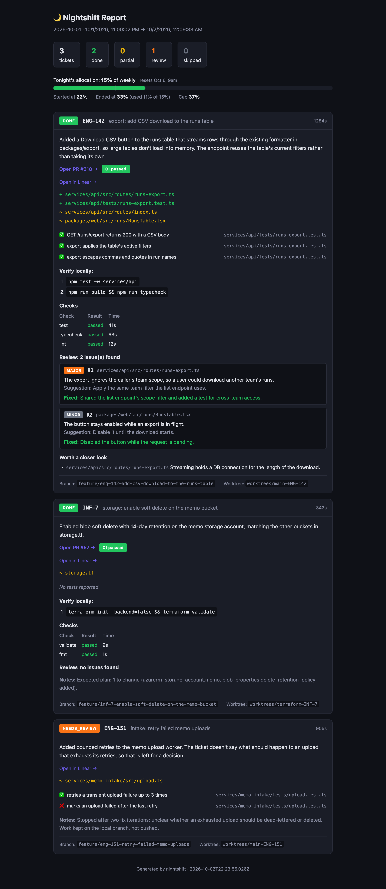

# Nightshift

Nightshift works through Linear tickets overnight with Claude Code. You pick the tickets before you log off. It works each one test-first in its own git worktree, reviews the change, fixes what the review finds and opens an Azure DevOps PR. In the morning there's an HTML report waiting.



<sub>The screenshot shows sample data.</sub>

## How a night runs

Cron starts the runner at 23:00. It reads the project's `tonight.md` and works the tickets in file order. For each ticket it:

1. **Fetches the Linear ticket** and moves it to In Progress.
2. **Creates a worktree** off `origin/main`, beside the repo it targets: `<repo path>-<ticket id>`, e.g. `~/Developer/app-ENG-123` for a repo at `~/Developer/app`. If the ticket already has an open PR, it continues on that PR's branch instead.
3. **Runs the repo's checks** (tests, typecheck, lint, or `terraform validate` and `fmt`) to get a baseline.
4. **Runs the agent** with the ticket, your context bullets and [`AGENTS.md`](AGENTS.md) plus the project's own `AGENTS.md`. The agent works test-first and ends with a structured report, including anything it spotted but didn't fix ("Spotted, not fixed" in the report).
5. **Re-runs the checks** against the baseline, so only failures the change introduced count as regressions.
6. **Reviews the diff** with read-only agents, one after another: four finders ([bugs](prompts/review-bugs.md), [spec](prompts/review-spec.md), [reuse](prompts/review-reuse.md), on the shared [`review.md`](prompts/review.md), and a Codex finder). The bugs finder runs twice, independently and with the same prompt, because a single pass catches a given bug in some runs and misses it in others; the passes run in the order bugs, bugs, spec, reuse, codex, and their candidates are numbered together. The Codex finder runs `gpt-6.1-sol` at high effort in a read-only sandbox, with the bugs prompt and the same candidate format, so its candidates go through dedupe and the confirm step like the others. It only finds; the confirm step and the fix review are Claude. When Codex is skipped or fails, because its allowance is used up, it isn't logged in or it hit its usage limit twice, the review line in the report says so and the ticket's status doesn't change. With more than four candidates, a cheap [dedupe run](prompts/dedupe.md) groups those that report the same problem; four or fewer already fit in one batch. The [confirm step](prompts/confirm.md) then judges them in batches of at most four groups, one batch after another, so each candidate gets a real reading. Every confirmed or rejected verdict cites the line it rests on and quotes it. The runner checks the quote against the file, and a rejection whose line doesn't check out is published as unproven. A rejection is only for a claim that is false: one that admits the behaviour happens is published as unproven, or as a ticket conflict when it quotes the ticket line. Unproven candidates become "worth a closer look" risks in the PR. A candidate showing that the ticket asks for something that works against the ticket's own goal is a ticket conflict. It is never fixed, it marks the ticket `needs_review`, and it is listed under "Decisions needed" at the top of the morning report and under "Needs a decision before merge" in the PR. Review runs use `claude-opus-5-5` at high effort; the dedupe run uses Sonnet at low effort with no tools. An agent then fixes what was confirmed ([`prompts/fix.md`](prompts/fix.md)). After the fix, a read-only fix review ([`prompts/fix-review.md`](prompts/fix-review.md)) checks each claimed fix and reviews the fixer's own diff, taken between snapshots of the worktree before and after the fix, including the callers and tests its changes reach. New issues it finds go through the confirm step and get one more fix round with its own fix review. A ticket conflict it finds goes to the decisions for a person, like the finders' ones. Anything still open after that is left for the morning (`needs_review` for a major, not published for a blocker). Token usage for every run is recorded in the session JSON and shown in the morning report.
7. **Commits and opens or updates the PR.** If CI fails, it pulls the failure logs and makes up to two attempts to fix them. It won't push to a PR that has auto-complete set.

8. **Runs a postmortem after the last ticket.** A read-only agent ([`.claude/skills/postmortem/SKILL.md`](.claude/skills/postmortem/SKILL.md)) reviews the night's logs and suggests changes to the instructions and workflow. It never edits anything. It's skipped on a dry run, when no ticket was worked, or when usage has run out, and the report says so.

Anything that can't be finished cleanly stays on a local branch, marked `needs_review`, with notes saying why. Tickets that end `done` or `needs_review` are moved to In Review in Linear, if the team has that state.

### Budget

Each night gets 15% of the weekly Claude usage, or the project's `allowancePercent`. `--allowance <pct>` overrides it for one run, e.g. `--allowance 100` the night before the weekly reset. An `allowance: <pct>` line in the header of `tonight.md` does the same for one night and is removed once the night is archived; `--allowance` wins over it. The runner reads usage with `claude -p /usage` before each ticket and stops picking up new tickets once the cap is reached. When the 5-hour session reaches 80%, it waits for the session to reset rather than running into extra usage. A Claude run stopped by the 5-hour limit resumes after the reset, up to twice, and only while the night's weekly cap is still open.

Codex has its own allowance: 20% of its weekly limit a night, not configurable per project, read with `codex app-server` before each Codex run. Codex waits for the 5-hour reset the same way, and a Codex run that hits its usage limit is retried once. The report shows a second bar, "Codex review allocation", and Codex tokens are listed apart from the Claude totals.

## Setup

You need Node 22 or later, the [Claude Code](https://claude.com/claude-code) CLI, the Azure CLI (`az`) with the DevOps extension, the [Codex CLI](https://developers.openai.com/codex/cli), and Docker (for the throwaway Postgres that database-backed tests run against).

```sh
npm install
cp .env.example .env
```

Fill in the root `.env`:

| Variable | What it's for |
| --- | --- |
| `LINEAR_API_KEY` | Fetching tickets and moving them to In Progress and In Review |
| `CLAUDE_CODE_OAUTH_TOKEN` | From `claude setup-token`. Cron can't read the login keychain. |
| `NIGHTSHIFT_PROJECT` | Project used when `--project` isn't passed |

Fill in the project's `.env` (see [Projects](#projects)). An empty value there falls through to the root `.env`:

| Variable | What it's for |
| --- | --- |
| `AZURE_DEVOPS_ORG`, `AZURE_DEVOPS_PROJECT`, `AZURE_DEVOPS_PAT` | Opening PRs and reading CI results |
| `BRANCH_PREFIX` | Optional prefix for ticket branches |

Run `codex login` once with your ChatGPT plan. The runner reads the login from `~/.codex/auth.json`, so cron needs no token.

Schedule it:

```cron
0 23 * * * cd /path/to/nightshift && npm run run -- --project <name> >> logs/cron.log 2>&1
```

## Projects

A project is the set of repos nightshift works in, plus the instructions and tickets for them. Each lives in `projects/<name>/`, which is gitignored apart from `projects/example/`:

| File | What it's for |
| --- | --- |
| `project.json` | Repos (`path`, `toolchain`, `description`), `defaultRepo`, optional `testDb` script, `allowancePercent` and `linearTeams` |
| `AGENTS.md` | Project instructions appended to the root [`AGENTS.md`](AGENTS.md): repo layout, services available, tools missing |
| `.env` | Azure DevOps settings and `BRANCH_PREFIX` for this project |
| `tonight.md` | Tonight's tickets |
| `test-db.sh` | Optional script that starts the throwaway Postgres |

`linearTeams` is a list of Linear team keys such as `["ENG"]`. When it's set, `prep-status` and the [dashboard](#dashboard) only list your Todo tickets from those teams. `/tonight` still lists every Todo ticket assigned to you, and tickets outside `linearTeams` show "—" in its prep column. Leave it out to see all of them. `/prep` and `/tonight` also use `prep-mark` and `prep-status` to keep track of which tickets have been prepped, described under [Prep memory](#prep-memory).

Start a new project by running `/nightshift-setup` from the root of its repo. The skill lives in [`skills/nightshift-setup`](skills/nightshift-setup/SKILL.md); link it into your user skills once with `ln -s "$PWD/skills/nightshift-setup" ~/.claude/skills/`. It writes `projects/<name>/`, runs the night's checks against the repo and reports where the repo doesn't fit. To do it by hand instead, copy [`projects/example`](projects/example) to `projects/<name>` and replace the placeholder paths in `project.json`; it won't load until they exist. Select a project with `--project <name>` or `NIGHTSHIFT_PROJECT`. For example, `npm run run -- --project <name>` runs it, and `--allowance <pct>` overrides its budget for one run.

## Each evening

Prep tickets one at a time with `/prep <ID> [project]` in Claude Code. It checks the ticket against the code, asks you about anything the agent would have to guess, and writes your answers into the Linear description. The agent also gets the comments, but as a raw thread, so settled decisions belong in the description.

A ticket that needs the unmerged code of another ticket in tonight's file can name it with `base: <ID>` (an earlier ticket in the same repo). It branches from that ticket's branch and opens its PR into it, and is skipped if the base wasn't pushed.

Draft `projects/<name>/tonight.md` from your Linear Todo list by running `/tonight [project]` in Claude Code, or write it by hand following [`projects/example/tonight.md`](projects/example/tonight.md):

```md
## ENG-142 – export: add CSV download to the runs table
repo: app
- Reuse the existing row formatter in packages/export; don't add a CSV dependency.
```

Preview the night without changing anything:

```sh
npm run run:dry -- --project <name>
```

The report lands in `reports/<name>/nightshift-<date>.html`. Agent output and run logs go to `logs/<name>/`. The runner then moves the night's tickets to `reports/<name>/nightshift-<date>-tonight.md`, leaving only the header in `projects/<name>/tonight.md`, so the next night doesn't rerun them.

## Each morning

Read `reports/<name>/nightshift-<date>.html`. Ticket conflicts are listed first, under "Decisions needed". Each one needs a decision: update the ticket or the code. The Postmortem section at the bottom lists suggested fixes to the instructions, also saved in `reports/<name>/nightshift-<date>-postmortem.md`. Ask Claude to implement the ones you pick by id, for example "implement P1 and P3". `/postmortem [date]` re-runs the postmortem by hand.

## Dashboard

The dashboard is a local web page for the evening and the morning. It shows what to prep and plan before you log off, and what needs you after a night. Besides reading and writing files in this repo, it calls Linear and Azure DevOps with the same credentials as the runner, runs the usage check, runs git in the configured repo paths and launches herdr.

### Install

```sh
npm run dashboard:install
```

This installs a LaunchAgent, `io.nightshift.dashboard`, that starts the dashboard at login and restarts it if it stops. Logs go to `logs/dashboard.log`. Run the install again after you move the repo or change Node, because the agent stores the repo path and the Node directory.

To run it in the foreground instead:

```sh
npm run dashboard
```

To uninstall:

```sh
launchctl bootout gui/$(id -u)/io.nightshift.dashboard && rm ~/Library/LaunchAgents/io.nightshift.dashboard.plist
```

Open <http://127.0.0.1:4100>. It listens on that address only, so nothing else on the network can reach it.

### Before clocking off

The home page has a project picker and a "Before clocking off" section for the selected project:

- **Todo tickets.** Your Linear Todo tickets, limited to the project's `linearTeams`, with priority, estimate, prep state, position in `tonight.md` and any open PR. Tickets that are in `tonight.md` but no longer in Todo are listed too, with their Linear state.
- **Prep state.** One of:
  - `fresh`: prepped with `/prep`, the description hasn't changed since and there are no newer comments.
  - `stale`: the description changed after `/prep`.
  - `new comments`: comments arrived after `/prep`.
  - `not ready`: `/prep` recorded blockers. Hover the badge to read them.
  - `inferred`: there's no `/prep` record, but the description already has a Decisions, Acceptance criteria or Pointers section.
  - `none`: no record and no such section.
- **Allowance and usage.** Tonight's allowance and where it comes from (`tonight.md` or the project default), and the weekly usage with its reset time, with the Codex weekly usage and its 20% nightly allowance next to it.
- **Warnings.** A ticket in `tonight.md` that Linear can't find, that isn't in Todo or isn't assigned to you; one that is unprepped, stale or not ready; a PR with auto-complete set, which the runner won't push to; and a weekly reset within 24 hours, when `allowance: 100` may be worth setting. If Linear is unavailable or `tonight.md` has a parse error, the page says so and still lists what it can.
- **Prep and Plan tonight.** Each row has a Prep button and the section has a Plan tonight button. They open a herdr workspace running `/prep <ID> <project>` or `/tonight <project>`. If herdr isn't installed or isn't running, the dashboard copies the equivalent `claude` command to your clipboard instead.
- **Refresh.** Clears the caches and reloads. Linear tickets are cached for 5 minutes, PRs and their CI results for 5 minutes, usage for 10 minutes and the Linear team list for 1 hour.

### Prep memory

`/prep` records what it did in `state/prep.json` with `prep-mark`:

```sh
npm run -s prep-mark -- <ID> --project <name> [--repo <repo>] [--not-ready "<blockers>"]
```

It re-fetches the ticket from Linear and stores a hash of the description. Without `--not-ready` the outcome is recorded as ready. `--not-ready` records the blockers instead. The hash is how the dashboard and `/tonight` know a description changed after the prep.

`prep-status` prints one JSON line per Todo ticket in the project's `linearTeams`, with its prep state. `/tonight` uses it for its prep column:

```sh
npm run -s prep-status -- --project <name>
```

### Each morning on the dashboard

- **Run banner.** While a night is running, a banner shows the ticket, the phase and the time elapsed. It reads `logs/<name>/run.json`, which the runner refreshes every minute. If the heartbeat is more than 3 minutes old, the banner says the run looks stopped.
- **Outstanding.** One list of what needs you: tickets that ended `needs_review`, `partial` or `error`, open PRs with their CI result, votes and auto-complete state, and the postmortem suggestions. Each item has a checkbox. The checkboxes are the same ones as in the report, kept in `state/actions.json`, so a tick in one shows in the other.
- **Nights.** One row per report with ticket counts, budget used, Codex used, duration, suggestions and outstanding items. Reports from before the JSON output only get a link. Reports directly under `reports/` are listed as project `legacy`.

### Projects

`/projects` lists each project with its overall file-check status: config, default repo, `.env` keys, `AGENTS.md` and the test database script. The `linearTeams` and `az` login checks run on the project's own page. Open a project to edit its `project.json`, or use "New project" to create one from `projects/example`. Creating a project doesn't write `.env`. It tells you which keys to fill in at `projects/<name>/.env`.

### Security

The server binds to 127.0.0.1 and only accepts requests whose `Host` is `127.0.0.1` or `localhost` on its port. Every write needs an `X-Nightshift: 1` header and, if there is an `Origin`, it has to be the dashboard's own. The one exception is ticking a checkbox in a report you opened from disk. That report sends the tick to the dashboard when it's running, and keeps it in the browser when it isn't.

## Development

```sh
npm test
npm run typecheck
```

### Replaying a review

`replay-review` re-runs the finders and the confirm step against a change from an earlier night, without the implementer run, the fixer or any PR. It spends real usage, so it isn't part of `npm test`:

```sh
npm run -s replay-review -- --project <name> --ticket <ID> --base <sha> \
  --diff logs/<name>/<ID>-diff-review.txt --report logs/<name>/<ID>-output.txt \
  [--session logs/<name>/session-<date>.json] [--related ID=<sha> ...] [--codex-model <slug>] [--no-install]
```

It adds a detached worktree under the system temp directory at `<sha>` and applies the diff there without committing, so new files stay untracked as they were at night. For a node repo it then runs `npm ci` and the repo's build script, so the finders can run tests; `--no-install` skips both. With `--session`, the ticket brief (the night's context lines and Linear snapshot) and the night's check results come from that session file and Linear isn't called; without it, the ticket is fetched from Linear and no check results are passed in. It parses the implementer's report and prints the confirmed findings, the risks (with a `[data]` marker), the ticket conflicts with the quoted ticket line, the overturned rejections, the rulings on the implementer's decisions, each lens's outcome (the bugs finder runs twice, so it appears as `bugs` and `bugs (pass 2)`), and the usage of every run with a total. Raw outputs go to `logs/<name>/replay-<date>/` (`replay-<date>-2` and so on for later runs that day), with the second bugs pass in its own `review-bugs-2` log, the dedupe run, when there was one, in `review-dedupe` and each confirm batch in its own `review-confirm-<n>` log, next to `replay.json`: the review record (candidates with their verdicts, lens runs, rulings), the usage of each run, the arguments and the nightshift commit that ran it. The temporary worktree is removed afterwards; your branches and other worktrees are never touched. `--related` takes related tickets for the reuse lens; give the related ticket's commit from that night, since its branch may have moved. `--codex-model` runs the Codex finder with another model slug than `gpt-6.1-sol`.

Replay the diff the finders saw. The runner saves it as `<ID>-diff-review.txt` before the review; `<ID>-diff.txt` is the final diff, after any fix. For a night older than that file whose fix run changed code, rebuild the pre-fix tree from the fix run's transcript (the `entrypoint: "sdk-cli"` session in the ticket's directory under `~/.claude/projects`): each Edit result carries the file's `originalFile`, so putting each edited file's first original back onto the post-fix commit gives the change the finders reviewed.

To judge a replay against a synthetic export example:

1. Use the base commit recorded for that change. For a stacked ticket, use its parent's commit from the same night rather than the current default branch. Check that the saved diff applies before running agents.
2. Write down the known issues in that diff, such as an export that reads only its first row or reports success without writing a file, and check whether the review surfaces them.
3. Check that choices left open by the ticket appear as risks or decisions, rather than being silently treated as requirements.
4. To exercise decision parsing, replay a report with choices in its notes and another with the same choices in a structured `decisions:` list.
5. Compare each lens's candidates with the confirmation verdicts and compare the usage cost with the original run.


#### Scoring against a golden set

A golden set lists the issues a review of one ticket should find, so runs can be compared. It holds client code details, so it lives in the gitignored `projects/<name>/golden/<ID>.json`:

```json
{
  "version": 1,
  "ticket": "ENG-1",
  "items": [
    {
      "id": "1-1",
      "file": "src/export.ts",
      "issue": "reads the first row only",
      "expect": "finding",
      "origin": "change",
      "match": { "files": ["src/export.ts"], "all": [["first row", "rows[0]"], ["only", "ignores"]] }
    }
  ],
  "noise": []
}
```

A candidate matches an item when its file is in `match.files` and every group in `match.all` has a term in its issue or suggestion, ignoring case; the confirm step's note is never searched. `expect` is `finding` when only a confirmed verdict counts. It is `decision` for behaviour the ticket itself asked for: a confirmed verdict counts, and so does a ticket conflict escalated for a person to decide. It is `surfaced` when a ticket conflict or an unproven verdict, published as a risk, is enough. `origin: "fix"` marks an issue the fixer introduced, which the finders never saw: it is reported but not counted. `guard: true` marks a finding the night confirmed and fixed, counted on its own line so a change that loses it shows up. `noise` lists candidates that were rightly rejected, in the same shape, so confirming everything can't pass for recall.

When `projects/<name>/golden/<ID>.json` exists, `replay-review` scores the run and writes `score.json` beside `replay.json`. `score-review` scores records offline at no cost: a night's session file (every ticket with a golden set) or replay records, in any mix:

```sh
npm run -s score-review -- --golden projects/<name>/golden logs/<name>/session-<date>.json logs/<name>/replay-*/replay.json
```

For each item it prints the candidates that match, with the lens and pass that found them or the decision they came from, and what the confirm step did: `confirmed`, `ticket_conflict`, `unproven`, `rejected`, `duplicate` (merged into a candidate that isn't this issue), `missing` (no verdict) or `unconfirmed` (the confirm step didn't run). Near misses are listed as `possible`, for you to check. Then the counts: found, confirmed, surfaced (confirmed, ticket conflict or unproven), met (what `expect` asks for) and lost at confirm, plus the guards confirmed, the noise confirmed, confirmed findings that match no entry, and the cost of each stage. `--json <file>` also writes the scores as JSON. Scoring the night's own session gives the line to beat.

### Replaying a fix review

`replay-fix-review` re-runs the fix review and its confirm step for one ticket from an earlier night, without the implementer, the fixer or any PR. It spends real usage too:

```sh
npm run -s replay-fix-review -- --project <name> --ticket <ID> --base <sha> --pre-diff <file> --diff <file> \
  --report logs/<name>/<ID>-output.txt --fix logs/<name>/<ID>-fix.txt --session logs/<name>/session-<date>.json
```

It adds a detached worktree under the system temp directory at `<sha>`, applies the pre-fix diff and snapshots the tree, then swaps to the final diff and snapshots that. The fix review sees the change between the two snapshots, the findings the fixer was given (from the session JSON), the fixer's own claims from the fix log, and any decisions the fixer added to the implementer's. It then runs the dedupe and confirm steps on what the fix review found, in batches like the review's, and prints the claim results, the fixer candidates with their verdicts, the confirmed findings with their new ids, the ticket conflicts, the risks, the confirm outcome when it wasn't fully confirmed, and the usage of every run with a total. Raw outputs go to `logs/<name>/replay-fix-<date>/`, with the dedupe run in `fix-review-dedupe` and each confirm batch in its own `fix-review-confirm-<n>` log. Nothing else is touched, and the temporary worktree is removed afterwards. There is no `node_modules` in the replay, so tests can't run.

`--diff` is the night's final `<ID>-diff.txt`, with `<ID>-fix-diff-2.txt` reversed first when a second round ran, so the fix review sees only round 1's change. The findings it is given are those the `--fix` log's FIXES block lists, round 1's inputs, so new fixer findings get ids after them.

To get the pre-fix diff for a night recorded since the fix review landed, apply the final `<ID>-diff.txt` to a checkout of the base, reverse `<ID>-fix-diff-2.txt` if there is one, then reverse `<ID>-fix-diff.txt`, and take the diff against the base. For earlier nights, rebuild it by undoing the fix run's edits from its transcript.

For a synthetic fix-review example, change a shared export-name helper and omit coverage for one of its callers. A useful review should identify the missing caller coverage and verify the fixes it was given. Use commit IDs from your own saved run; this repo does not include another project's source or replay logs.

## License

[MIT](LICENSE), copyright 2026 Adam Fox.
