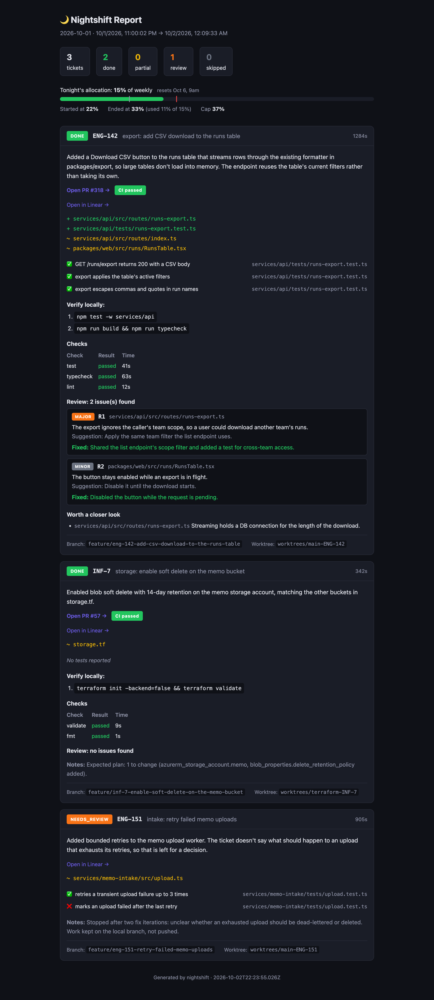

# Nightshift

Nightshift works through Linear tickets overnight with Claude Code. Pick the tickets before you log off. Each gets its own git worktree, baseline checks, implementation, independent review and an Azure DevOps PR. In the morning, an HTML report shows what passed and what needs a decision.

This is a personal tool shared as-is. Support is best-effort, and changes still need human review before merging.



<sub>The screenshot shows sample data.</sub>

## How it works

1. Sweep your own active PRs for unanswered review comments and work each PR that has some like a ticket on its branch, replying to and resolving the threads it fixes.
2. Read an ordered ticket list from `tonight.md`, which can mix projects, and fetch each ticket's description and comments.
3. Create an isolated worktree, or continue an existing PR, and record the repo's checks before making changes.
4. Run Claude Code test-first, then compare checks against the baseline.
5. Review the diff through independent bug, spec and reuse passes, plus a Codex pass. Confirm findings against the code, fix confirmed issues, and review the fixes.
6. Open or update the PR, attempt repairs for failing CI, and write the morning report. Ambiguous requirements and unresolved issues are left for a person to review.

The runner controls commits and publication. Agent permissions and network access are restricted. Weekly usage budgets limit when new work can start; they are not dollar spending caps.

See [architecture and design decisions](docs/architecture.md) for the review process, isolation, failure handling and budget behavior.

## Supported scope

| Area | Supported today |
| --- | --- |
| Ticket tracker | Linear |
| PR host and CI | Azure DevOps |
| Coding agents | Claude Code, with an additional Codex review pass |
| Target repos | Any repo whose setup and checks are shell commands |
| Runtime | Node 22.12+ or Node 24 LTS, Git and a Unix shell |
| Platforms | Developed on macOS; CI checks Node 22 and 24 on Linux. Dashboard startup installation uses macOS LaunchAgents. |

Adding projects on this stack is configuration work. Each repo's setup and check commands are project configuration. New ticket trackers and PR hosts need code changes. There is no connector interface yet. [Supported scope and extension points](docs/supported-scope.md) maps the assumptions and the work a new connector would require.

## Setup

Install the Claude Code, Codex and Azure CLIs before configuring an unattended run. Whatever runtimes a project's checks need (npm, Terraform, .NET and so on) and Docker for its test database must be installed too.

```sh
git clone https://github.com/adam-c-fox/nightshift.git
cd nightshift
npm ci
cp .env.example .env
mkdir -p logs
```

Follow [setup and daily use](docs/setup.md) to configure credentials, install the bundled skills, add a project and schedule it. Start with a dry run before enabling cron:

```sh
npm run run:dry
```

Dry runs read external services and write local logs and reports, but do not edit target repos or publish PRs. A completed night writes `reports/night/nightshift-<date>.html`.

For the evening and morning views, run `npm run dashboard` and open <http://127.0.0.1:4100>. See the [dashboard guide](docs/dashboard.md) for prep state, outstanding actions and automatic startup.

## Development

```sh
npm ci
npm test
npm run typecheck
```

[CI](.github/workflows/ci.yml) runs the tests and type checks on Node 22 and 24. These checks need no service credentials and do not run paid agents. Review replay commands do spend agent usage; see [review replay and scoring](docs/review-replay.md).

## Documentation

- [Setup and daily use](docs/setup.md): credentials, projects, skills, scheduling and morning reports.
- [Architecture and design decisions](docs/architecture.md): worktrees, checks, review confirmation and budgets.
- [Supported scope and extension points](docs/supported-scope.md): platform assumptions and adding providers.
- [Dashboard](docs/dashboard.md): evening planning, outstanding work and local HTTP security.
- [Review replay and scoring](docs/review-replay.md): reproduce a review, compare golden sets and inspect fix reviews.

## License

[MIT](LICENSE), copyright 2026 Adam Fox.
